# ⚜ zoetty

## What is zoetty?

**Tiny terminal demos from real output, kept honest by CI.**

zoetty turns terminal sessions into small, looping, animated clips made of plain SVG or HTML and CSS. No video, no GIF, no JavaScript.

[](https://pypi.org/project/zoetty)




That's zoetty, recorded by zoetty. Every clip in this README is built from a spec in [`docs/clips/`](https://github.com/phalt/zoetty/tree/main/docs/clips).

## Why use zoetty?

- **Demos that can't go stale** - `zoetty record` captures what your commands really print, and `zoetty check` fails CI the moment a clip stops matching. CI doesn't even need your tool installed.
- **Tiny** - Clips are a few KB of text, not megabytes of GIF. zoetty itself is pure Python with two dependencies: no ffmpeg, no browser, no Node.
- **Nothing new to learn** - A clip is a short TOML file, the same format as your `pyproject.toml`. No custom scripting language.
- **Made for agents** - Paste [one prompt](#use-it-with-your-coding-agent) and your coding agent writes, records, builds and checks the clip for you.
- **Plays everywhere** - The SVG works anywhere images do, GitHub and PyPI included. The same spec builds an HTML fragment with selectable text for your docs. Every clip has alt text and respects reduced motion.

[Why zoetty, in more detail](https://phalt.github.io/zoetty/why/)

## Install

```sh
uv tool install zoetty
```

Or with pip:

```sh
pip install zoetty
```

zoetty needs Python 3.12 or later, and runs on **macOS and Linux**.

## Quick start

```sh
zoetty init docs/clips/hello.toml    # write a starter spec
zoetty build docs/clips/hello.toml   # render it to docs/clips/hello.svg
```

Then put it in your README like any image:

```markdown

```

## A basic clip

Two commands, with their output written by hand:

```toml
title = "~/my-project"
label = "Typing two commands in a terminal: echo prints a greeting, ls lists three files"
cols = 60

[[run]]
cmd = "echo 'Hello from zoetty!'"
lines = ["Hello from zoetty!"]

[[run]]
cmd = "ls"
lines = ["[blue]docs[/]  README.md  [green]tool.py[/]"]
```


## Recording real output

Give a run an `output` file and `zoetty record` runs the command for real and saves what it printed. `input` is typed into interactive programs, a line at a time, once each prompt is waiting:

```toml
title = "python"
label = "A Python REPL importing zoetty's markup parser and parsing some styled text"
cols = 64

[record]
env = { PYTHON_BASIC_REPL = "1" }

[[run]]
cmd = "python -q"
output = "captures/repl.ansi"
input = """
from zoetty.markup import parse, plain
plain(parse("[bold]zoe[/]tty"))
[s.styles for s in parse("[bold green]ok[/] done")]
"""
```

```sh
zoetty record docs/clips/repl.toml
zoetty build docs/clips/repl.toml
```



Long output scrolls once it passes `rows`, and `[theme]` recolours the whole window:



See [more examples](https://phalt.github.io/zoetty/examples/), including the HTML output and hand-timed clips.

## Use it with your coding agent

zoetty is easy for coding agents to drive: specs are small text files, and every command says what it did. Paste this into Claude Code, Codex, Cursor or similar:

```text
Use zoetty to add an animated terminal demo of this project to the README.
Read https://phalt.github.io/zoetty/agents/ first and follow it: install zoetty,
write a clip spec in docs/clips/ that shows the most useful commands, record the
real output with `zoetty record`, build it with `zoetty build`, look at the result,
embed the SVG in README.md, and add `zoetty check docs/clips/*.toml` to CI.
```

## Documentation

👉 Read the [full documentation](https://phalt.github.io/zoetty/) for the clip format, every command, embedding clips and more examples.

Want to help? See [CONTRIBUTING.md](https://github.com/phalt/zoetty/blob/main/CONTRIBUTING.md).
