# 🎬 Examples

Every example here is a real spec from [`docs/clips/`](https://github.com/phalt/zoetty/tree/main/docs/clips), built by zoetty. Some are shown as their SVG and some as their HTML fragment: the HTML ones have text you can select.

## Hello: output written by hand

The smallest useful clip. Nothing is recorded: each run's `lines` say what it printed, using [markup](clip-format.md#markup) for colour.

```toml
--8<-- "clips/hello.toml"
```

As an SVG:



And the same spec as an HTML fragment:

--8<-- "clips/hello.html"

## Quick start: recording real output

zoetty recording itself. Each run has an `output` file, so `zoetty record` runs it for real and keeps its colours. `[record]` runs the commands in a scratch folder, and `setup` empties it first, so the clip is the same every time it's recorded. `exec` is what actually runs; `cmd` is what's shown.

```toml
--8<-- "clips/quickstart.toml"
```

--8<-- "clips/quickstart.html"

## A REPL: typing into an interactive program

`input` is typed into the program while it's recorded, one line each time it goes quiet, so every line lands after the prompt that asked for it. After the last line zoetty sends Ctrl-D, which ends the REPL and brings back the shell prompt. `env` turns on Python's plain REPL, which doesn't redraw the line as you type.

```toml
--8<-- "clips/repl.toml"
```



## Scrolling and themes

`rows` sets how much of the terminal is visible: past that, output scrolls up line by line. `line_gap` slows the output down so it can be read, and `[theme]` recolours the window, here to One Dark.

```toml
--8<-- "clips/zen.toml"
```

--8<-- "clips/zen.html"

## Hand-timed steps

For clips that aren't a series of commands, `[[step]]` entries say exactly when each line appears and `[type ...]` types text out. This one re-enacts a [paulrun](https://github.com/phalt/paulrun) session and is the clip on paulrun's README.

```toml
--8<-- "clips/steps.toml"
```



## In the wild

- [paulrun](https://github.com/phalt/paulrun): the README demo
- [clientele](https://github.com/phalt/clientele): the README, plus the [client generator docs](https://docs.clientele.dev/openapi-cli/)
- [clientele.dev](https://clientele.dev): a REPL clip under the code, and the generator in action
