# 🎨 Themes

Pick a theme with one line in your spec:

```toml
theme = "catppuccin-mocha"
```

The presets are the themes people most often use in their terminal and editor, with colours taken from [Ghostty](https://ghostty.org)'s bundled themes. `zoetty themes` lists them in your terminal.

## Presets

| `theme =` | |
|---|---|
| `catppuccin-latte` |  |
| `catppuccin-mocha` |  |
| `dracula` |  |
| `everforest` |  |
| `github-dark` |  |
| `github-light` |  |
| `gruvbox-dark` |  |
| `gruvbox-light` |  |
| `kanagawa` |  |
| `monokai-classic` |  |
| `monokai-pro` |  |
| `nord` |  |
| `one-dark` |  |
| `rose-pine` |  |
| `solarized-dark` |  |
| `solarized-light` |  |
| `tokyo-night` |  |

Each is built from a spec in [`docs/clips/themes/`](https://github.com/phalt/zoetty/tree/main/docs/clips/themes).

## Changing a preset

Give `[theme]` a `name` to start from a preset, then set the colours you want to change:

```toml
[theme]
name = "dracula"
bg = "#1e1f29"
```

To see every colour a preset sets, print it with `zoetty themes NAME`.

## Making your own

A theme is nine colours. These are zoetty's defaults, used for anything you don't set. Copy the table into a spec and change it:

```toml
[theme]
bg = "#1c1c1c"
fg = "#d0d0d0"
bar = "#2a2a2a"
blue = "#4b8fe3"
green = "#2fcf7a"
yellow = "#e6e04a"
red = "#e05252"
cyan = "#4fc6d6"
magenta = "#c678dd"
```

`bg` is the background, `fg` the text, and `bar` the window bar. The other six colour text marked up as `[blue]`, `[green]` and so on, or printed in those ANSI colours by a recorded command. Bright ANSI colours use the same six.

## Restyling HTML clips with CSS

An [HTML fragment](embedding.md#html-in-a-docs-site) keeps its theme in CSS custom properties, on the clip's outer `<div>`. For a clip built to `demo.html`, with the default theme, the fragment's `<style>` has:

```css
.zt-demo {
  --bg: #1c1c1c;
  --fg: #d0d0d0;
  --bar: #2a2a2a;
  --blue: #4b8fe3;
  --green: #2fcf7a;
  --yellow: #e6e04a;
  --red: #e05252;
  --cyan: #4fc6d6;
  --magenta: #c678dd;
}
```

Every class starts with `zt-` and the output file's name, so you can restyle a clip from your page's own stylesheet, without touching the built file:

| Class | What it is |
|---|---|
| `zt-demo` | The window: background `--bg`, text `--fg` |
| `zt-demo-bar` | The window bar: background `--bar` |
| `zt-demo-screen` | The terminal screen, inside the window |
| `zt-demo-blue`, `-green`, `-yellow`, `-red`, `-cyan`, `-magenta` | Coloured text, using the variable of the same name |
| `zt-demo-bold`, `-dim`, `-italic` | Text styles |
| `zt-demo-caret` | The blinking cursor, in `--fg` |
| `zt-demo-replay` | The [replay button](embedding.md#html-the-replay-button), in clips that stop |

The fragment's `<style>` comes after your stylesheet, so give your rules a little more weight than a single class. `div.zt-demo` is enough:

```css
/* One clip */
div.zt-demo {
  --bg: #1e1e2e;
  --fg: #cdd6f4;
  --bar: #181825;
}

/* Every zoetty clip on the page */
div[class^="zt-"] {
  --blue: #89b4fa;
  --green: #a6e3a1;
}

/* More than colours */
div.zt-demo {
  border-radius: 0;
  box-shadow: none;
}
div.zt-demo .zt-demo-bold {
  color: var(--yellow);
}
```

This is also the quickest way to match a docs site's own light and dark modes: set the variables inside a `prefers-color-scheme` media query, or under whatever class your site's theme switcher sets.

SVG clips shown as images can't be styled from the page: an `` keeps its CSS to itself. Use `theme` in the spec for those.

## For agents

To match a project's colours, set `theme` to the closest preset, or print one with `zoetty themes NAME` and change its colours in the spec. For HTML fragments on a docs site, override the CSS variables above in the site's stylesheet rather than editing the built `.html` file, which `zoetty build` overwrites.
